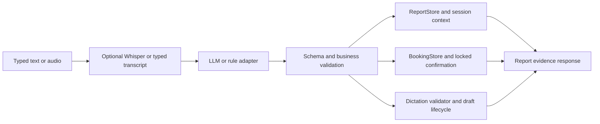

# Architecture (one page)

```
 voice ──► STT (Whisper, optional) ──┐
 typed text ─────────────────────────┴─► transcript
                                           │
                        ┌──────────────────▼───────────────────┐
                        │ LLM adapter (propose only)            │  llm.py
                        │  interpret(): intent, name, type      │  tool calling, forced schema
                        │  propose_findings(): findings+evidence│  timeout -> rule fallback
                        └──────────────────┬───────────────────┘
                                           │ untrusted JSON
                        ┌──────────────────▼───────────────────┐
                        │ Business-rule validation              │  validators.py / vocab.py
                        │  closed intents/types, name format,   │
                        │  vocabulary, verbatim evidence, FDI   │
                        └───────┬──────────────────┬───────────┘
                  retrieval/follow-up             dictation
                        │                          │
          ┌─────────────▼─────────────┐   ┌────────▼─────────────────┐
          │ Deterministic tools        │   │ Report generation         │ dictation.py
          │ store.py: find_patients,   │   │ accepted findings ->      │
          │ reports_for (exact/ambig/  │   │ structured JSON + draft   │
          │ fuzzy/none), session ctx   │   │ text, needs_review=True   │
          └─────────────┬─────────────┘   └────────┬─────────────────┘
                        └──────────┬───────────────┘
                              response {status, report|draft, sources, warnings}
```

**Flow 1: retrieval.** Transcript -> LLM extracts `{intent, patient_name, report_type, recency}` -> validated
-> `Store.find_patients` returns exact / ambiguous / fuzzy / none -> only an *exact* unique match proceeds to
`reports_for` (latest first). Ambiguous or fuzzy returns candidates and selects nothing. A missing report type
returns `no_report` plus the available types. Exact matches with a near-identical neighbour (Nair/Nayar) carry a DOB-verification warning.

**Flow 2: dictation.** Transcript -> LLM proposes findings, each with a verbatim `evidence` quote -> validator
accepts only vocabulary terms whose evidence appears in the transcript and states the site -> accepted findings
become editable JSON (`certainty: stated|uncertain`, `polarity`, FDI site, `needs_review: true`) and a templated
draft marked "requires clinician review". Rejected claims and unconverted statements are surfaced, never silently dropped or "fixed".

**Flow 3: follow-up.** The session stores the last opened patient/report. "Summarize her report" reuses it only if
a patient is selected and the pronoun is consistent with that patient; otherwise it asks. The summary is built
from the stored report and returns `sources` with the report id and quoted evidence.

**Flow 4: scan booking.** Booking intent extraction produces `{scan_type, appointment_date, appointment_time,
patient_name}`. The deterministic `BookingStore` returns configured synthetic slots. The first response is always
`booking_options` or `booking_confirmation_required`; only an explicit `confirm booking` performs a locked
availability recheck and creates a booking ID. Unavailable and duplicate requests return errors without success.

**Flow 5: report-aware chatbot.** Questions about findings, impression, date, or clinician reuse the selected
report and return only stored evidence plus the report ID. Unsupported treatment or diagnostic questions are
refused rather than inferred.

**Flow 6: draft lifecycle.** `/dictate` creates a uniquely identified draft. `/drafts/{id}` supports retrieval
and controlled editing; finalization requires `clinician_reviewed: true`; DELETE discards the draft. All state is
in-memory for this synthetic PoC.



**Separation of concerns.** The LLM never touches data or decides identity. Every state change or data read is a
deterministic function over validated input.
